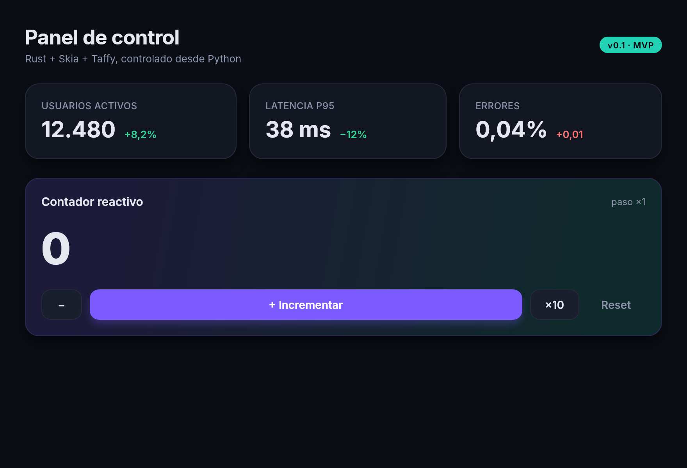

# Aurora

UI de escritorio declarativa para Python con núcleo nativo en Rust.


Python describe la interfaz; Rust hace todo lo que ocurre por frame.

```python
from aurora import App, Signal, button, card, text

clicks = Signal(0)

def view():
    return card(padding=32)[
        text(lambda: f"Clicks: {clicks()}", size=32, weight=700),
        button("+1", lambda: clicks.update(lambda c: c + 1)),
    ]

App(view, title="Demo").run()
```

## Arquitectura

```
Python  ── view() → árbol de Element ── to_spec() ──┐   (1 cruce por reconstrucción)
                                                     ▼
Rust    spec.rs   dict → Node tipado (+ herencia de estilos de texto)
        render.rs Taffy (flexbox) → Skia (rrect, sombras, gradientes, texto)
                  estado de animación hover/pressed, interpolado por frame
        window.rs winit + softbuffer; Skia pinta directo en el framebuffer
                  el bucle corre sin el GIL; Python solo se toma en callbacks
```

| Pieza | Crate |
|---|---|
| Puente Python | `pyo3` + `maturin` (wheel abi3, Python ≥ 3.10) |
| Layout | `taffy` (flexbox; grid disponible) |
| Render + texto | `skia-safe` (raster CPU por ahora) + `textlayout` |
| Ventana | `winit` + `softbuffer` |

## Desarrollo (con uv)

Requisitos: [uv](https://docs.astral.sh/uv/) y Rust (`rustup`). En Linux, además,
`libfontconfig` y `libfreetype` (paquetes `-dev`).

```bash
uv sync                                     # crea .venv, compila el núcleo Rust (release) e instala editable
uv run examples/hello.py                    # abre la ventana
uv run examples/hello.py --png out.png      # render headless (tests de snapshot / CI)
```

- Los cambios en `python/aurora/` se ven al instante (instalación editable).
- Los cambios en `src/*.rs` o `Cargo.toml` disparan la recompilación solos en el
  siguiente `uv run` (ver `cache-keys` en `pyproject.toml`).
- Para forzarla a mano: `uv sync --reinstall-package aurora-ui`.

La primera compilación descarga los binarios precompilados de Skia (~2 min).

## Estado del MVP

Funciona: layout flex, texto con shaping real, sombras, bordes, gradientes,
herencia de estilos de texto, tokens de tema (`"$primary"`), hover/pressed
animados en Rust, `press_scale`, clicks, render headless a PNG.

Limitaciones conscientes (siguientes pasos):

1. **Reactividad**: hoy cualquier evento reconstruye la vista completa.
   Siguiente: signals de grano fino que invaliden solo su rama, con diff
   de árbol por `key` y caché de layout/párrafos entre frames.
2. **GPU**: raster CPU vía softbuffer. Siguiente: backend Skia GPU
   (Metal / D3D / Vulkan / GL) detrás de un trait `Surface`.
3. **Widgets**: scroll, input de texto (cursor, selección, IME), imágenes.
4. **Canvas** de dibujo inmediato y charts nativos alimentados con numpy/polars.
5. **Hilos y asyncio**: despertar el bucle (`EventLoopProxy`) cuando un Signal
   cambia desde otro hilo o una corrutina.
6. Hot reload, devtools, accesibilidad (AccessKit).
