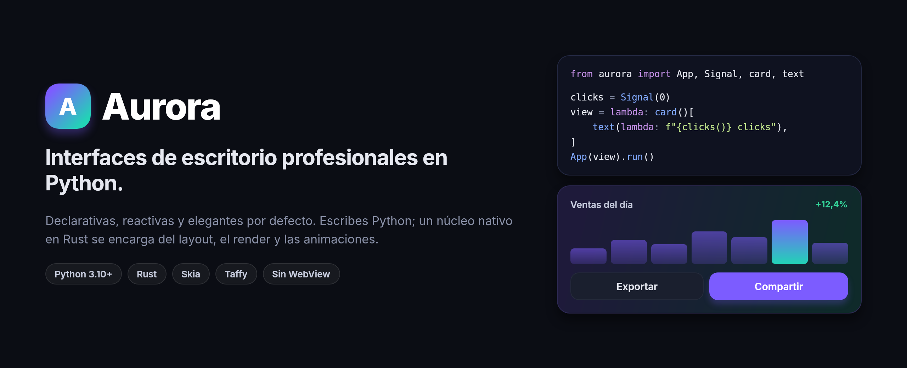

---
hide:
  - navigation
---

# Aurora { .sr-only }

<div class="aurora-hero" markdown>



<p class="tagline">Interfaces de escritorio profesionales, rápidas y elegantes, escritas solo en Python.</p>

Declarativas · Reactivas · Núcleo nativo en Rust · Sin WebView

[Empezar la guía](guide.md){ .md-button .md-button--primary }
[Referencia](reference.md){ .md-button }

</div>

!!! warning "Pre-alfa"

    La API puede cambiar entre versiones menores. Ya sirve para herramientas internas y
    prototipos; todavía no para producción.

Describes la interfaz como una función de tu estado; Aurora se encarga del resto con un motor
nativo escrito en Rust: layout, tipografía, render, animaciones y eventos.

```python live size=720x240
from aurora import App, Signal, button, card, row, text

clicks = Signal(0)
clicks.set(3)  # oculto


def view():
    return card(padding=32, gap=16)[
        text(lambda: f"{clicks()} clicks", size=40, weight=800),
        row(gap=8)[
            button("Restar", lambda: clicks.update(lambda c: c - 1), variant="soft"),
            button("Sumar", lambda: clicks.update(lambda c: c + 1)),
        ],
    ]


App(view, title="Contador").run()
```

!!! tip "Ejemplos vivos"

    Todas las imágenes de los ejemplos de esta documentación se generan **ejecutando su código**
    con la versión publicada de Aurora, en el tema (claro u oscuro) que estés usando. Si un ejemplo
    dejara de funcionar, la documentación no se publicaría.

## Por qué Aurora

<div class="grid cards" markdown>

- **Solo Python.** Sin HTML, CSS, JavaScript, bundlers ni servidor local. Tu lógica llama directo
  a tu base de datos, a una API o a un modelo de IA desde el handler de un botón.
- **Rendimiento nativo.** Layout, render y animaciones corren en Rust (Skia + Taffy), fuera del
  intérprete y sin el GIL. Python solo interviene cuando cambia tu estado.
- **Elegante por defecto.** Tipografía con shaping real, sombras suaves, gradientes y
  transiciones animadas incluidas. Un `button()` sin configurar ya se ve bien.
- **Declarativa y componible.** La jerarquía se lee como markup (`column()[...]`) y los
  componentes son funciones Python normales.
- **Reactiva.** El estado vive en `Signal`s y la interfaz se mantiene sincronizada sola.
- **Testeable sin pantalla.** `app.render_png()` y `app.pilot()` renderizan y simulan clics,
  teclas y rueda con el mismo motor que la ventana.

</div>

## Inicio rápido

Necesitas Python ≥ 3.11, [uv](https://docs.astral.sh/uv/) y Rust ([rustup](https://rustup.rs)).
En Linux también `libfontconfig-dev` y `libfreetype-dev`.

```bash
git clone https://github.com/YoshiLoL0526/aurora.git
cd aurora
uv sync                     # compila el núcleo Rust e instala en modo editable
uv run examples/hello.py    # tu primera ventana
uv run aurora dev app.py    # tu app, con hot reload
```

## Por dónde seguir

- [**Guía**](guide.md): de cero a una app completa, paso a paso.
- [**Referencia**](reference.md): todas las primitivas, componentes y propiedades de estilo.
- [**Galería**](examples.md): los ejemplos del repositorio, renderizados.
- [**Arquitectura**](architecture.md): cómo funciona el núcleo y por qué está diseñado así.
