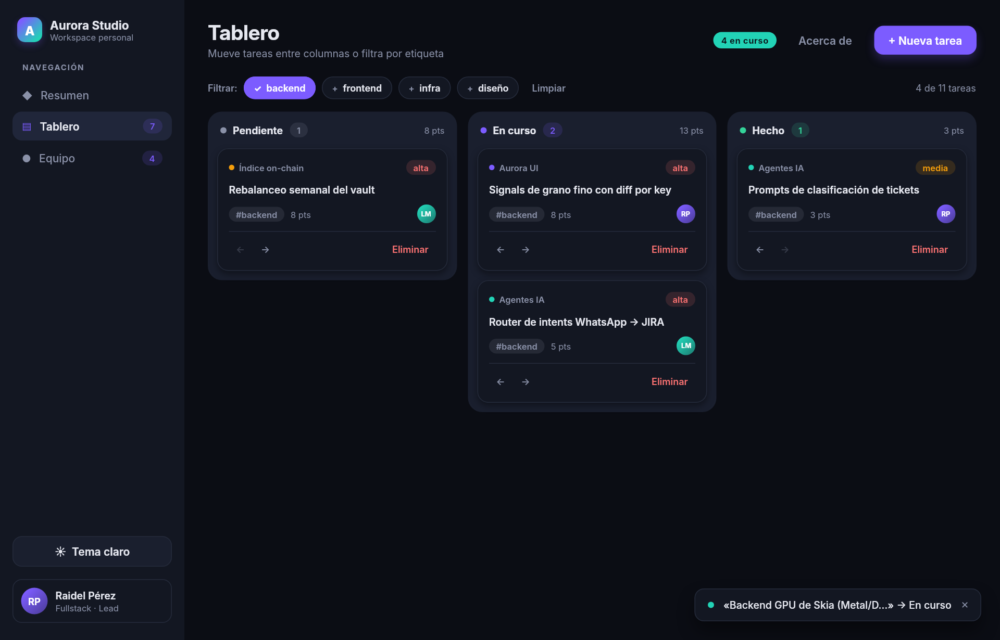
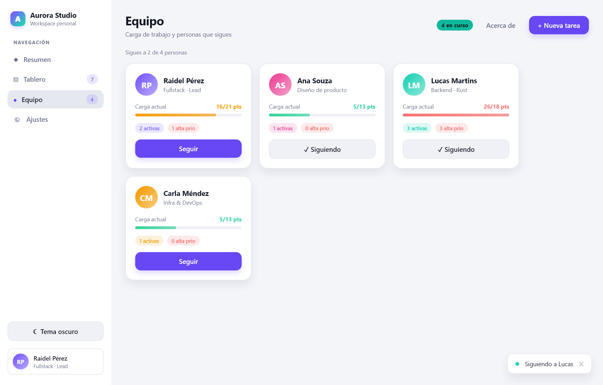

# Ejemplos

Todos se ejecutan desde la raíz del repositorio con `uv run`. Los que aceptan `--png` renderizan
sin abrir ventana, útil para ver el resultado en un servidor o en CI.

| Ejemplo | Qué muestra | Comando |
|---|---|---|
| [`hello.py`](hello.py) | Lo esencial: layout, tarjetas de métricas, botones y un contador reactivo. | `uv run examples/hello.py` |
| [`studio.py`](studio.py) | Una app completa: navegación entre vistas, kanban con búsqueda, gráfico interactivo, formulario de nueva tarea (Ctrl+N), ajustes con `tabs`/`switch`/`select`/`textarea`, modal con confirmación, toasts, tooltips y tema claro/oscuro. | `uv run examples/studio.py` |
| [`canvas.py`](canvas.py) | Dibujo inmediato con `canvas`: gráfico de líneas con rejilla y un indicador circular que se redibujan al cambiar los datos. | `uv run examples/canvas.py` |
| [`charts.py`](charts.py) | Gráficos nativos con `chart`: línea de dos series (polars), área que se actualiza con datos mutados en sitio, barras por categoría y dispersión. | `uv run examples/charts.py` |
| [`brand.py`](brand.py) | Genera el banner y el logo del README con la propia librería. | `uv run examples/brand.py` |

```bash
uv run examples/hello.py --png hola.png
uv run examples/studio.py --png capturas/
```

<p align="center">
   
</p>
